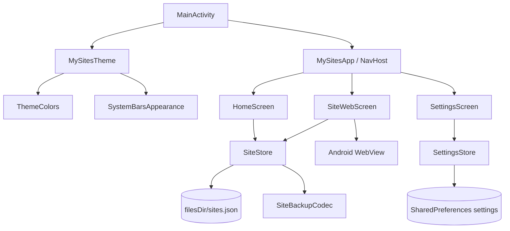
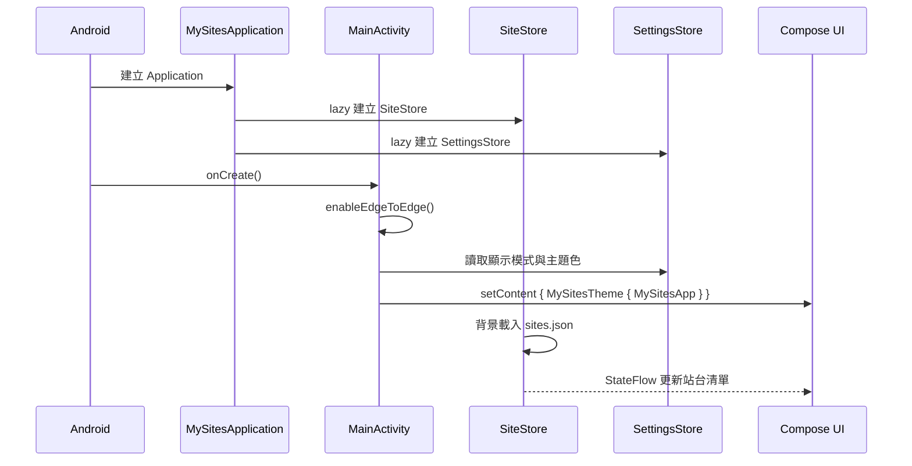

# 系統架構與技術文件

本文說明「我的站台」的技術選型、模組分工、資料流與關鍵實作細節。

## 1. 技術棧

| 類別 | 技術 | 版本／設定 |
| --- | --- | --- |
| 語言 | Kotlin | 2.2.20 |
| UI | Jetpack Compose + Material 3 | Compose BOM 2025.09.00 |
| 導覽 | Navigation Compose | 2.8.5 |
| 非同步 | Kotlin Coroutines / StateFlow | 1.10.2 |
| JSON | kotlinx.serialization | 1.9.0 |
| 拖曳排序 | Reorderable | 2.5.1 |
| 建置 | Android Gradle Plugin / Gradle | 8.13.2 / 8.14.3 |
| SDK | minSdk / targetSdk / compileSdk | 26 / 36 / 36 |
| 簽署 | Debug keystore（prerelease） | `~/.android/debug.keystore` |

## 2. 高階架構



App 採用單一 Activity + Compose Navigation。沒有額外的 ViewModel 層；`SiteStore` 與 `SettingsStore` 建立於 `Application`，以 `StateFlow` 暴露狀態，畫面直接訂閱並呼叫操作方法。這樣的結構適合目前規模，也讓資料在畫面切換時保持一致。

## 3. 啟動流程



`SettingsStore` 在建構時同步讀取 SharedPreferences，避免第一次畫面先顯示錯誤主題再切換。`SiteStore` 則在 IO dispatcher 載入 JSON，載入完成前首頁顯示進度指示。

## 4. 模組與套件

```text
com.example.mysites
├── MainActivity.kt
├── MySitesApplication.kt
├── data
│   ├── AppSettings.kt       # ThemeMode、AppSettings、預設色相
│   ├── SettingsStore.kt     # SharedPreferences + StateFlow
│   ├── Site.kt              # Site、SiteBackup
│   ├── SiteBackupCodec.kt   # JSON 編解碼與清洗
│   ├── SiteStore.kt         # 站台狀態與檔案持久化
│   └── UrlNormalizer.kt     # 網址正規化與驗證
└── ui
    ├── MySitesApp.kt        # NavHost 與路由
    ├── home/HomeScreen.kt   # 首頁、清單、搜尋、拖曳、對話框
    ├── settings/SettingsScreen.kt
    ├── theme
    │   ├── Theme.kt         # MaterialTheme、系統列外觀
    │   └── ThemeColors.kt   # 6 組預設色與 HSL 色盤
    └── web/SiteWebScreen.kt # WebView、標題列、錯誤頁
```

## 5. 資料層

### 5.1 資料模型

```kotlin
@Serializable
data class Site(
    val id: String = "",
    val name: String,
    val url: String,
    val createdAt: Long = 0L,
)
```

- `id`：UUID 字串；匯入缺少 ID 時自動產生。
- `name`：站台顯示名稱。
- `url`：已正規化的 `http` / `https` 網址。
- `createdAt`：建立時間（毫秒）。

備份外層：

```kotlin
@Serializable
data class SiteBackup(
    val version: Int = 1,
    val exportedAt: String = "",
    val sites: List<Site> = emptyList(),
)
```

### 5.2 SiteStore

`SiteStore` 是站台資料的唯一來源：

- 檔案位置：`context.filesDir/sites.json`
- 以 `MutableStateFlow<List<Site>>` 保存目前清單。
- 所有異動（新增、編輯、刪除、排序、匯入）都先更新記憶體狀態，再安排持久化。
- 使用 `synchronized` 保護狀態與寫檔排程。
- 寫檔延遲 300ms（debounce），避免拖曳排序時高頻寫檔。
- `MainActivity.onStop()` 呼叫 `flush()`，確保離開前景前寫入。
- 寫檔採「暫存檔 + rename」：
  1. 寫入 `sites.json.tmp`
  2. `renameTo(sites.json)`
  3. 若 rename 失敗，改為直接覆寫後刪除暫存檔

載入失敗（例如 JSON 損壞）時會回退為空清單，App 仍可啟動。

### 5.3 SiteBackupCodec

- 使用 `kotlinx.serialization` 的 `Json`。
- 匯出：`prettyPrint = true`、`encodeDefaults = true`，包含 `version`、`exportedAt`、`sites`。
- 匯入：
  - 支援標準備份物件。
  - 也支援最外層直接是 `Site` 陣列的 JSON。
  - `ignoreUnknownKeys = true`，可忽略未來新增欄位。
  - 清洗規則：
    - 去除名稱前後空白，空白名稱略過。
    - 網址經 `UrlNormalizer` 正規化，無效者略過。
    - 缺少 ID 時產生 UUID。
    - 重複 ID 只保留第一筆。
    - `createdAt <= 0` 時補上目前時間。

### 5.4 UrlNormalizer

`UrlNormalizer.normalize()` 的處理順序：

1. 去除前後空白；空白或含空白字元者拒絕。
2. 若已是 `scheme://` 形式，保留原樣。
3. 若形似 `host:port`（例如 `localhost:8080`、`example.com:8080`），補上 `https://`。
4. 若看起來是其他 scheme（例如 `javascript:`、`mailto:`），拒絕。
5. 其餘輸入補上 `https://`。
6. 只接受 `http` / `https`。
7. 使用 `URI` 驗證 host；Unicode 網域以 `IDN.toASCII()` 檢查。

### 5.5 SettingsStore

- 使用 `SharedPreferences`（檔名 `settings`）。
- 鍵值：
  - `theme_mode`：`SYSTEM` / `LIGHT` / `DARK`
  - `theme_hue`：0～360 的整數
- 建構時同步讀取，無效值回退為 `SYSTEM` 與 `215`。
- `setThemeMode()` 立即更新 StateFlow 並寫入。
- `setThemeHue(hue, persist)`：
  - 滑桿拖曳期間 `persist = false`，只更新 UI。
  - 放開滑桿時呼叫 `persistThemeHue()` 寫入，降低寫檔頻率。

## 6. UI 層

### 6.1 MainActivity

- 呼叫 `enableEdgeToEdge()`。
- 取得 `MySitesApplication` 的兩個 Store。
- 以 `collectAsStateWithLifecycle()` 訂閱設定。
- 將 `themeMode`、`themeHue` 傳入 `MySitesTheme`。
- `onStop()` 時呼叫 `SiteStore.flush()`。

### 6.2 MySitesApp / NavHost

路由：

| Route | 畫面 |
| --- | --- |
| `home` | 站台清單 |
| `settings` | 設定頁 |
| `site/{siteId}` | 站台 WebView |

- 首頁點擊站台以 `site.id` 導覽。
- 設定頁使用 `launchSingleTop = true`，避免重複堆疊。
- 若站台在瀏覽頁開啟期間被刪除，會自動 `popBackStack()` 回上一頁。

### 6.3 HomeScreen

- `Scaffold` + `TopAppBar`：
  - 匯入 JSON
  - 匯出 JSON
  - 設定（齒輪）
- 搜尋列：即時過濾名稱與網址。
- `LazyColumn` + `ReorderableItem`：
  - 長按拖曳把手排序。
  - 搜尋中停用拖曳。
  - 卡片點擊開啟站台。
  - 右側 `DropdownMenu` 提供編輯／刪除。
- 對話框：
  - 新增／編輯站台（名稱、網址驗證）
  - 刪除確認
  - 匯入確認（顯示匯入數量與目前數量）
- 匯出／匯入使用 Activity Result API：
  - `CreateDocument("application/json")`
  - `OpenDocument()`
  - 檔案讀寫在 `Dispatchers.IO` 執行。

### 6.4 SiteWebScreen

- 自訂 52dp 標題列：返回箭頭 + 站台名稱（過長省略）。
- `BackHandler`：
  - `webView.canGoBack()` 為真 → `goBack()`
  - 否則 → `onBack()` 回清單
- `LinearProgressIndicator` 顯示載入進度。
- 載入錯誤或 SSL 錯誤時顯示錯誤覆蓋層與重試按鈕。
- `AndroidView` 建立 WebView，離開畫面時 `stopLoading()` + `destroy()`。
- 以 `WindowInsets` 處理狀態列、瀏海與導覽列，保留最大瀏覽空間。

### 6.5 SettingsScreen

- `TopAppBar` + 返回箭頭。
- 顯示模式：`SingleChoiceSegmentedButtonRow`。
- 主題色彩：
  - 6 個 40dp 觸控區、30dp 圓形色塊。
  - 選取中顯示外環。
  - 點擊立即更新 hue。
- Hue 滑桿：
  - 左側 32dp 目前色彩圓形色塊。
  - 自訂彩虹漸層 track。
  - `onValueChange` 即時預覽；`onValueChangeFinished` 持久化。
  - 下方顯示目前色彩名稱。
- 頁面可垂直捲動。

## 7. 主題系統

### 7.1 顯示模式

`ThemeMode`：

```kotlin
enum class ThemeMode { SYSTEM, LIGHT, DARK }
```

`MySitesTheme` 依模式決定 `darkTheme`：

- `SYSTEM`：`isSystemInDarkTheme()`
- `LIGHT`：`false`
- `DARK`：`true`

### 7.2 色彩產生

`ThemeColors.kt` 以 HSL 產生 Material 3 `ColorScheme`：

- 6 個預設色相：8°、40°、95°、165°、215°、285°。
- 淺色模式：primary 亮度 0.42、容器亮度 0.90。
- 深色模式：primary 亮度 0.76、容器亮度 0.28～0.30。
- `onPrimary`、`onSecondary`、`onTertiary` 依背景亮度自動選擇深色或白色文字。
- 覆寫 `surfaceContainerLowest`～`surfaceContainerHighest`、`outline`、`inverse*` 等角色，避免未覆寫角色沿用 Material 預設紫色。
- 不使用 Android 12+ 的 dynamic color，確保使用者選色能實際生效。

`ThemeColorsTest` 會針對多個色相與淺／深色模式檢查主要文字／背景對比度至少 4.5:1。

### 7.3 系統列

`Theme.kt` 的 `SystemBarsAppearance`：

- 使用 `WindowCompat.getInsetsController()`。
- 設定：
  - `isAppearanceLightStatusBars = !darkTheme`
  - `isAppearanceLightNavigationBars = !darkTheme`
- 以 `LaunchedEffect(darkTheme, view)` 在主題變更時立即更新。
- 系統列背景維持 edge-to-edge 透明，由 App 的 Compose 背景顯示主題色。

## 8. WebView 實作

### 8.1 設定

```kotlin
javaScriptEnabled = true
domStorageEnabled = true
loadsImagesAutomatically = true
mediaPlaybackRequiresUserGesture = true
allowFileAccess = false
allowContentAccess = false
mixedContentMode = MIXED_CONTENT_NEVER_ALLOW
builtInZoomControls = true
displayZoomControls = false
useWideViewPort = true
loadWithOverviewMode = true
```

Cookie：

- 啟用 Cookie。
- 啟用第三方 Cookie，以提高登入與嵌入內容相容性。

### 8.2 WebViewClient

- `shouldOverrideUrlLoading`：
  - `http` / `https` 留在 WebView。
  - 其他 scheme 以 `Intent.ACTION_VIEW` 交給系統。
- `onReceivedError`：僅處理主頁面錯誤。
- `onReceivedSslError`：一律 `handler.cancel()`，不略過憑證錯誤。
- `onPageStarted` / `onPageFinished` 更新進度。

### 8.3 WebChromeClient

- `onProgressChanged` 更新進度。
- `onCreateWindow` 處理 `target="_blank"` / `window.open()`：
  - 建立暫存 WebView 接收新視窗。
  - 攔截第一個 URL 後改在原本的 WebView 載入。
  - 導覽完成後銷毀暫存 WebView。

### 8.4 下載

使用 `DownloadManager`：

- Android 10（API 29）以上：`setDestinationInExternalPublicDir(DIRECTORY_DOWNLOADS, ...)`
- Android 8～9：`setDestinationInExternalFilesDir(...)`
- 通知列顯示下載進度與完成通知。

## 9. 儲存與檔案

| 資料 | 位置 | 格式 |
| --- | --- | --- |
| 站台清單 | `filesDir/sites.json` | JSON（pretty print） |
| 站台暫存檔 | `filesDir/sites.json.tmp` | JSON |
| 顯示模式／主題色 | SharedPreferences `settings` | String / Int |

App 不需要外部儲存權限。匯出／匯入透過 SAF 取得使用者選擇的 URI。

## 10. 權限與安全

### 10.1 權限

```xml
<uses-permission android:name="android.permission.INTERNET" />
```

沒有讀寫儲存、定位、相機、麥克風等權限。

### 10.2 網路安全

- `network_security_config.xml` 允許 cleartext traffic，以支援 `http://` 站台。
- 這是刻意的功能取捨；Lint 會顯示 `InsecureBaseConfiguration` 警告。
- WebView 不略過 SSL 錯誤。
- 關閉檔案與內容存取，降低本機檔案暴露風險。

### 10.3 資料隱私

- 站台資料只存在 App 私有儲存空間。
- 沒有分析、廣告或追蹤 SDK。
- 匯出檔案由使用者自行選擇位置。

## 11. 建置與測試

### 11.1 Build Type

| Build Type | Minify | Shrink Resources | Signing | Version |
| --- | --- | --- | --- | --- |
| `debug` | 否 | 否 | Debug | `1.0.0` |
| `release` | 否 | 否 | 未設定 | `1.0.0` |
| `prerelease` | 是 | 是 | Debug | `1.0.0-prerelease` |

### 11.2 測試

- `UrlNormalizerTest`：9 項
- `SiteBackupCodecTest`：5 項
- `ThemeColorsTest`：4 項
- 合計 18 項 JVM 單元測試。

執行：

```powershell
.\gradlew.bat :app:testDebugUnitTest
.\gradlew.bat :app:lintDebug
```

### 11.3 驗證限制

目前開發環境沒有連接 Android 裝置或模擬器，因此尚未完成：

- WebView 實際瀏覽行為
- 系統列圖示在各種 Android 版本的視覺確認
- Launcher 圖示遮罩與縮放確認
- R8 壓縮後的實機執行測試

建置、單元測試與 Lint 均已通過。

## 12. 已知限制

- 部分網站會阻擋 WebView、要求特定瀏覽器或限制第三方登入。
- 憑證錯誤不會被略過，自簽憑證站台無法載入。
- `http://` 連線未加密。
- 匯入會取代全部站台，不支援合併。
- 尚未提供站台分類、我的最愛、密碼保護或雲端同步。
- Pre-release 使用 Debug 金鑰，不適合正式發佈。

## 13. 相關文件

- [使用指南](使用指南.md)
- [系統設計文件](系統設計文件.md)
- [建置與發行指南](建置與發行指南.md)
- [v1.0.0-prerelease 發行說明](發行說明-v1.0.0-prerelease.md)
