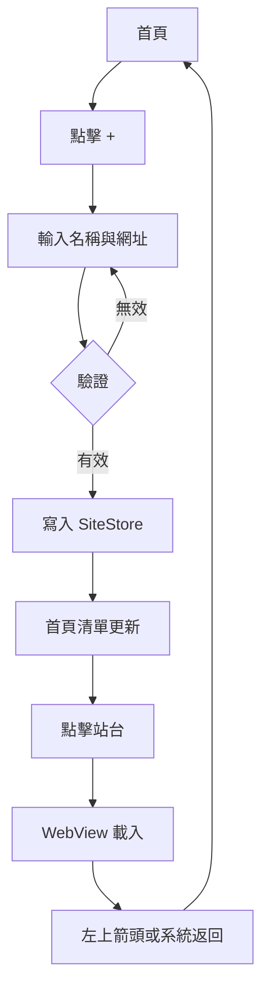
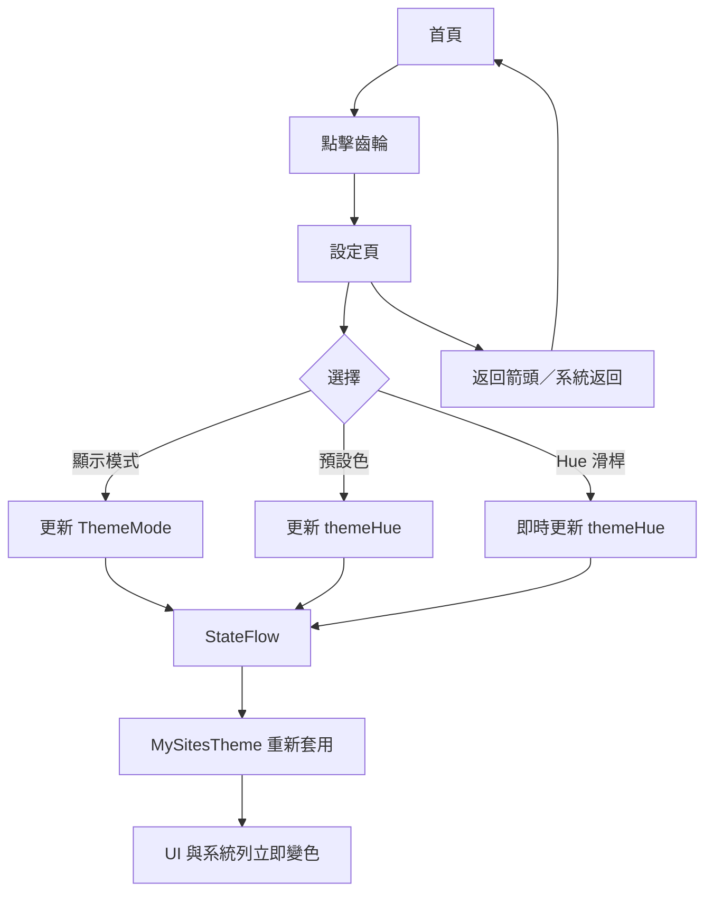
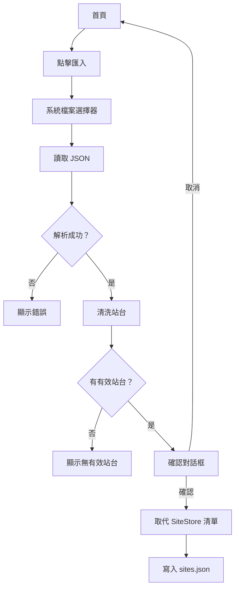

# 系統設計文件

本文記錄「我的站台」的設計目標、需求對照、使用者流程、資料模型、介面設計與重要設計決策。

## 1. 設計目標

1. **簡單**：不需要帳號或設定，開啟 App 就能管理常用網站。
2. **快速**：點擊站台即可在 App 內瀏覽，返回路徑清楚。
3. **本機優先**：所有資料留在裝置，匯出 JSON 即為完整備份。
4. **個人化**：提供活潑、易讀的淺色／深色主題與自訂主題色。
5. **可維護**：以 Kotlin、Jetpack Compose 與清楚的資料層拆分實作。

## 2. 範圍

### 2.1 包含

- 站台清單的新增、讀取、編輯、刪除
- 搜尋與拖曳排序
- App 內 WebView 瀏覽
- JSON 匯出／匯入
- 顯示模式與主題色彩設定
- Adaptive App 圖示
- Pre-release 建置與 GitHub Release

### 2.2 不包含

- 使用者帳號、雲端同步
- 跨裝置即時同步
- 站台分類、標籤、我的最愛
- 密碼管理或自動填入
- 廣告、分析、追蹤
- 正式商店上架與正式簽署金鑰管理

## 3. 需求對照

| 需求 | 實作 |
| --- | --- |
| App 名稱「我的站台」 | `strings.xml` 的 `app_name` |
| 新增站台：名稱、網址 | `SiteEditorDialog` + `SiteStore.add()` |
| 首頁顯示站台名稱清單 | `HomeScreen` 的 `LazyColumn` |
| 點擊站台在 App 內顯示 | `NavHost` → `SiteWebScreen` + WebView |
| 站台顯示空間盡量大 | 52dp 標題列 + edge-to-edge + WebView 填滿剩餘空間 |
| 顯示站台名稱、左側返回箭頭 | `SiteWebScreen` 自訂標題列 |
| 返回上一頁 | 箭頭固定回清單；系統返回鍵先處理 WebView 歷史 |
| 匯出所有站台 JSON | SAF `CreateDocument` + `SiteBackupCodec` |
| 設定按鈕（齒輪）在右上角 | `HomeScreen` TopAppBar 最後一個 action |
| 顯示模式：系統／淺色／深色，預設系統 | `ThemeMode` + `SettingsStore` + `MySitesTheme` |
| 系統列與導覽列跟隨主題 | `WindowCompat` 設定 light status/navigation bars |
| 6 個活潑主題色圓形色塊 | `ThemePresets` + `SettingsScreen` |
| Hue 彩色滑桿、左側目前色彩圓形色塊 | `SettingsScreen` 自訂 Slider track + 色塊 |
| 主題色與滑桿連動 | 同一個 `themeHue` 狀態 |
| 點擊後立即呈現 | StateFlow → 根層 recomposition |
| 設定頁返回箭頭／系統返回回主畫面 | TopAppBar navigationIcon + NavHost back stack |
| App 圖示改為地球儀、粗線條卡通 | `ic_launcher_foreground.xml` |
| 核心圖案 66dp 安全區的 85% | 地球直徑 56dp（26..82） |
| 108dp 圖層、72dp 裁切、66dp 安全區 | Adaptive icon 標準 + 向量尺寸 |

## 4. 使用者流程

### 4.1 新增並開啟站台



### 4.2 設定主題



### 4.3 匯入



## 5. 資料模型

### 5.1 Site

| 欄位 | 型別 | 說明 |
| --- | --- | --- |
| `id` | String | UUID；匯入缺少時自動產生 |
| `name` | String | 顯示名稱，不可空白 |
| `url` | String | 正規化後的 http/https URL |
| `createdAt` | Long | 建立時間（毫秒） |

### 5.2 SiteBackup

| 欄位 | 型別 | 說明 |
| --- | --- | --- |
| `version` | Int | 備份格式版本，目前為 1 |
| `exportedAt` | String | ISO-8601 匯出時間 |
| `sites` | List<Site> | 站台清單，陣列順序即顯示順序 |

### 5.3 AppSettings

| 欄位 | 型別 | 預設 | 說明 |
| --- | --- | --- | --- |
| `themeMode` | ThemeMode | `SYSTEM` | 顯示模式 |
| `themeHue` | Int | `215` | 主題色相 0～360 |

## 6. 畫面設計

### 6.1 首頁

```text
┌────────────────────────────────────┐
│ 我的站台              ↑ ↓ ⚙        │
├────────────────────────────────────┤
│ [搜尋站台........................] │
├────────────────────────────────────┤
│ ⠿  範例網站                        │
│    https://example.com          ⋮  │
├────────────────────────────────────┤
│ ⠿  另一個站台                      │
│    https://example.org          ⋮  │
│                                    │
│                              (+)   │
└────────────────────────────────────┘
```

設計重點：

- 標題列右側依序為匯入、匯出、設定。
- 搜尋列固定在清單上方。
- 站台卡片以名稱作為主要資訊，網址作為次要資訊。
- 拖曳把手位於卡片左側，避免與點擊開啟衝突。
- 刪除與編輯放在右側選單，減少誤觸。

### 6.2 站台瀏覽頁

```text
┌────────────────────────────────────┐
│ ←  站台名稱                        │
├────────────────────────────────────┤
│ ▓▓▓▓▓▓▓▓▓▓░░░░░░░░  (載入進度)     │
├────────────────────────────────────┤
│                                    │
│            WebView                 │
│                                    │
│                                    │
└────────────────────────────────────┘
```

設計重點：

- 標題列只有 52dp，最大化網站顯示空間。
- 進度條只在載入中出現。
- 錯誤覆蓋層提供明確原因與重試。
- 系統列與瀏海以 WindowInsets 處理，避免遮擋內容。

### 6.3 設定頁

```text
┌────────────────────────────────────┐
│ ←  設定                            │
├────────────────────────────────────┤
│ 顯示模式                           │
│ [ 系統 ][ 淺色 ][ 深色 ]           │
│                                    │
│ 主題色彩                           │
│ ●  ●  ●  ●  ●  ●                  │
│                                    │
│ 自訂色彩                           │
│ ●  [彩虹 Hue 滑桿──────────]       │
│ 目前色彩：天空藍                   │
└────────────────────────────────────┘
```

設計重點：

- 顯示模式使用 segmented buttons，三個選項一目了然。
- 預設色以小型圓形色塊呈現，選取中顯示外環。
- Hue 滑桿左側保留目前色彩圓形色塊，符合「所見即所得」。
- 所有變更立即套用，不需要「儲存」按鈕。
- 設定頁可垂直捲動，適用小螢幕。

## 7. 主題色彩設計

### 7.1 預設色

| 名稱 | Hue | 風格 |
| --- | --- | --- |
| 珊瑚紅 | 8° | 溫暖、活力 |
| 陽光橘 | 40° | 明亮、友善 |
| 活力綠 | 95° | 清新、輕快 |
| 薄荷綠 | 165° | 涼爽、平靜 |
| 天空藍 | 215° | 預設、穩定 |
| 葡萄紫 | 285° | 柔和、個性 |

### 7.2 色盤策略

- 以 HSL 產生 primary、secondary（+24°）、tertiary（+180°）。
- 淺色模式使用低亮度 primary 與高亮度容器。
- 深色模式使用高亮度 primary 與低亮度容器。
- 文字顏色依背景相對亮度自動選擇，並以單元測試檢查 4.5:1 對比度。
- 覆寫 Material 3 的 surface container 系列，避免出現與主題不相關的預設紫色。

### 7.3 立即套用

```text
SettingsScreen
    │ setThemeHue / setThemeMode
    ▼
SettingsStore (StateFlow)
    │ collectAsStateWithLifecycle
    ▼
MainActivity
    │ themeMode / themeHue
    ▼
MySitesTheme
    │ remember(themeHue, darkTheme)
    ▼
MaterialTheme + SystemBarsAppearance
```

設定值在拖曳期間只更新 StateFlow；放開滑桿才寫入 SharedPreferences。

## 8. App 圖示設計

### 8.1 規格

| 項目 | 數值 |
| --- | --- |
| 圖層尺寸 | 108 × 108 dp |
| 外框裁切區 | 72 × 72 dp |
| 安全區 | 66 × 66 dp（21..87） |
| 核心圖案 | 56 dp（26..82），約安全區 85% |
| 地球外框 | 5 dp |
| 經緯線 | 2.5 dp |

### 8.2 圖層

- **背景**：`ic_launcher_background.xml`，黃色到珊瑚色漸層。
- **前景**：`ic_launcher_foreground.xml`
  - 天空藍球體 `#7ED6FF`
  - 深藍外框 `#16324F`
  - 經緯線（赤道、兩條緯線、兩條經線）
  - 無陸地、無表情
- **Monochrome**：`ic_launcher_monochrome.xml`
  - 白色線稿地球與經緯線，供 Android 13+ 主題圖示使用。

### 8.3 Adaptive Icon

```xml
<adaptive-icon>
    <background android:drawable="@drawable/ic_launcher_background" />
    <foreground android:drawable="@drawable/ic_launcher_foreground" />
    <monochrome android:drawable="@drawable/ic_launcher_monochrome" />
</adaptive-icon>
```

## 9. 錯誤處理

| 情境 | 處理 |
| --- | --- |
| 網址格式錯誤 | 儲存按鈕停用，網址欄位顯示錯誤提示 |
| JSON 格式錯誤 | Snackbar 顯示「匯入失敗：JSON 格式不正確」 |
| JSON 無有效站台 | Snackbar 顯示「匯入失敗：沒有有效的站台」 |
| 站台檔案損壞 | 載入失敗時回退為空清單，App 仍可啟動 |
| WebView 主頁面載入失敗 | 顯示錯誤覆蓋層與重試按鈕 |
| SSL 憑證錯誤 | 取消連線，顯示憑證錯誤訊息 |
| 匯出失敗 | Snackbar 顯示「匯出失敗」 |
| 站台在瀏覽中被刪除 | 自動返回上一頁 |
| 拖曳排序寫檔失敗 | 目前版本未額外提示；下次異動會再嘗試寫入 |

## 10. 設計決策

### 10.1 為何使用 JSON 檔案而不是 Room？

站台資料量小、結構單純，且需求包含 JSON 匯出。直接以 `sites.json` 作為主要儲存格式可讓匯出／備份與內部儲存一致，減少一層對應與遷移成本。

### 10.2 為何使用 SharedPreferences 而不是 DataStore？

設定只有兩個值，且需要在第一帧前同步取得主題，避免主題閃爍。SharedPreferences 的同步讀取符合此需求，也不需要額外依賴。

### 10.3 為何不使用 ViewModel？

`SiteStore` 與 `SettingsStore` 建立在 Application 層級，生命週期長於 Activity；畫面直接訂閱 StateFlow 即可。以目前規模而言，這比為每個畫面建立 ViewModel 更精簡。

### 10.4 為何移除 dynamic color？

Android 12+ 的 dynamic color 會以桌布色彩覆蓋 App 主題。需求要求使用者能選擇 6 種預設色與自訂 Hue，因此必須停用 dynamic color。

### 10.5 為何允許 cleartext HTTP？

使用者可能加入 NAS、路由器或內部服務的 `http://` 位址。若全面禁止，會限制實際使用情境；因此允許 cleartext，並在文件中提醒風險。

### 10.6 為何箭頭與系統返回鍵行為不同？

- 箭頭是「回到站台清單」的明確導覽。
- 系統返回鍵符合瀏覽器直覺：先回上一頁網頁，沒有歷史才回清單。

## 11. 未來擴充

- 站台分類、標籤、我的最愛
- 匯入合併模式與衝突處理
- 自訂首頁、圖示或 favicon
- 密碼保護／生物辨識鎖定
- 匯出加密備份
- 桌面小工具快速開啟站台
- 單獨的 WebView 網域白名單
- 正式簽署金鑰與 Play Store 發行流程

## 12. 相關文件

- [使用指南](使用指南.md)
- [系統架構與技術文件](系統架構與技術文件.md)
- [建置與發行指南](建置與發行指南.md)
- [v1.0.0-prerelease 發行說明](發行說明-v1.0.0-prerelease.md)
